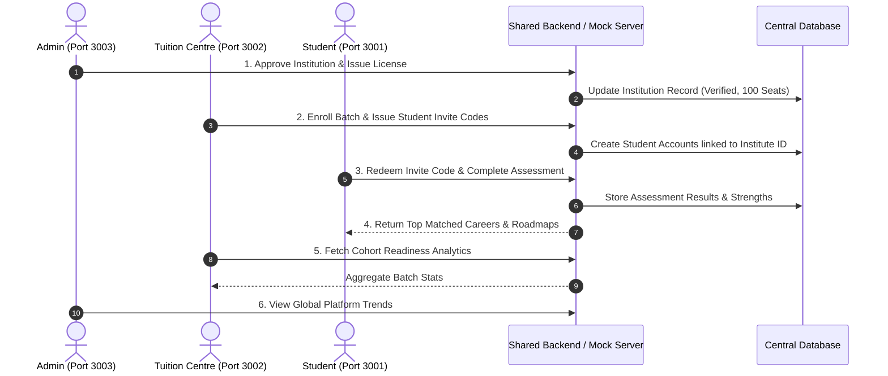

# ZHERO — System Architecture & Integration Plan

> **KSUM She Builds Hackathon 2026**  
> *Monorepo Architecture & Integration Roadmap*

---

## 1. Monorepo Structure

```text
zhero/
├── apps/
│   ├── student/               # Student Web App (Port 3001)
│   ├── tuition-centre/        # Tuition Centre Web App (Port 3002)
│   └── admin/                 # Admin Console (Port 3003)
├── shared/
│   ├── styles/                # Brand tokens, CSS variables, utility classes
│   │   └── tokens.css
│   ├── components/            # Reusable UI components across apps
│   │   ├── BrandNavbar.jsx
│   │   ├── StatCard.jsx
│   │   ├── Button.jsx
│   │   └── Badge.jsx
│   └── config/                # App metadata, ports, API routes, constants
│       └── index.js
├── docs/
│   ├── PROJECT_OVERVIEW.md    # Product model & stakeholder specs
│   ├── ARCHITECTURE.md        # Monorepo architecture & integration plan
│   ├── DESIGN_SYSTEM.md       # Color palettes, typography & UI tokens
│   └── CONTRIBUTION_GUIDE.md  # Git branching workflow & team rules
├── .gitignore
├── README.md
└── package.json
```

---

## 2. Independent Frontend Architecture

Each application in `apps/` is an autonomous React application powered by **Vite**:
- **Independent Package Scripts:** Each app can be developed, built, and previewed in complete isolation without running the other two.
- **Port Isolation:**
  - Student: `3001`
  - Tuition Centre: `3002`
  - Admin: `3003`
- **Vite Path Aliasing:**
  Each `vite.config.js` configures `@shared` pointing directly to the root `shared/` directory:
  ```javascript
  resolve: {
    alias: {
      '@shared': path.resolve(__dirname, '../../shared'),
    },
  }
  ```
  This eliminates duplicate CSS or component copy-pasting while keeping builds completely decoupled.

---

## 3. Shared Layer Specifications

### 1. `shared/styles/tokens.css`
Declares the single source of truth for the ZHERO brand:
- Core color palette (Oranges, Peaches, Neutrals)
- Responsive typography scales
- Border radii, shadows, and transition curves
- Micro-utility classes (`.btn-primary`, `.btn-secondary`, `.card`, `.badge`)

### 2. `shared/components/`
Modular, framework-agnostic React components styled strictly with design tokens:
- `BrandNavbar`: Unifies header branding and offers seamless local switching between ports.
- `StatCard`: Consistent metric representation across dashboards.
- `Button` & `Badge`: Unified tactile feel and status signaling.

### 3. `shared/config/index.js`
Centralized application manifest declaring ports, URLs, descriptive metadata, and target API endpoints.

---

## 4. Integration Plan (Connecting the 3 Apps)

During the hackathon, each developer works independently with mock datasets to maximize velocity. The following plan details how the three apps integrate:



### Key Integration Contracts:

#### A. Shared Authentication & Session Propagation
- **Protocol:** JWT Bearer tokens or unified Cookie-based session (`zhero_session`).
- **User Roles:** `STUDENT`, `TUITION_ADMIN`, `PLATFORM_ADMIN`.
- **Single Sign-On (SSO):** A common auth endpoint allows seamless redirection to the respective portal based on role claims.

#### B. Common Data Models
```typescript
// Shared Interface Contracts (Future TypeScript / Schema Definition)
interface Institution {
  id: string;
  name: string;
  location: string;
  tier: 'STARTER' | 'GROWTH' | 'ENTERPRISE';
  allocatedSeats: number;
  usedSeats: number;
  status: 'PENDING' | 'APPROVED' | 'SUSPENDED';
}

interface Student {
  id: string;
  institutionId: string;
  name: string;
  email: string;
  batch: string;
  assessmentStatus: 'NOT_STARTED' | 'IN_PROGRESS' | 'COMPLETED';
  topCareerMatch?: string;
  readinessScore?: number;
}

interface CareerProfile {
  id: string;
  title: string;
  industry: string;
  averageSalaryBracket: string;
  demandRating: 'HIGH' | 'VERY_HIGH';
  coreSkills: string[];
  prerequisites: string[];
}
```

#### C. Backend & API Deployment
- **API Architecture:** RESTful microservice or lightweight Express/FastAPI service.
- **Production Routing:**
  - `student.zhero.app` -> Student App
  - `partners.zhero.app` -> Tuition Centre App
  - `admin.zhero.app` -> Admin App
  - `api.zhero.app` -> Central Backend API
