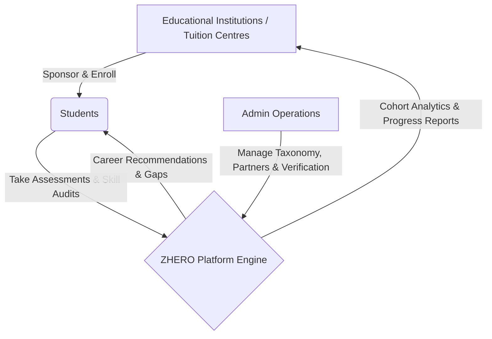

# ZHERO — Project Overview

> **KSUM She Builds Hackathon 2026**  
> *Empowering Next-Gen Careers Through Institutional Guidance*

---

## 1. Executive Summary

**ZHERO** is a B2B2C career guidance and educational support ecosystem that connects students with structured career roadmaps, assessments, and educational institutions.

Rather than selling directly to students with low conversion, ZHERO operates on a **B2B2C partnership model**:
- **Educational Institutions & Tuition Centres** subscribe to ZHERO as institutional customers.
- **Students** gain free, sponsored access to premium assessments, personalized career recommendations, and skill-gap analysis through their enrolled centres.
- **Tuition Centres** increase student retention and value proposition by offering high-tech career intelligence alongside standard coaching.
- **Platform Operators (Admin)** manage verification, institutional billing, skills taxonomy, and market intelligence.

---

## 2. Core Stakeholders & Value Propositions

### 👩‍🎓 1. Students (Target: High School & Undergraduate Youths)
- **Career Assessments:** Interactive discovery quizzes evaluating logical, verbal, spatial, and domain aptitudes.
- **Tailored Recommendations:** AI-driven matching of individual strengths to emerging high-demand career paths.
- **Skill-Gap Analysis:** Actionable diagnostics showing what skills are missing to enter a chosen field.
- **Learning Roadmaps:** Step-by-step milestones with vetted resources and project ideas.
- **Zero-Barrier Access:** Free access sponsored by their enrolled tuition centre.

### 🏫 2. Tuition Centres & Coaching Academies (B2B Paying Customers)
- **Differentiated Value Proposition:** Offer cutting-edge career mentoring in addition to exam preparation.
- **Cohort Dashboard:** Real-time visibility into batch completion rates, common career interests, and student readiness.
- **Performance Reports:** Share professional readiness summaries with parents and stakeholders.
- **Seat Allocation Management:** Self-service license management for active batches.

### ⚙️ 3. Platform Administration (ZHERO Ops)
- **Partner Verification:** Vetting and approving tuition centres and educational partners.
- **Career Taxonomy & Skills Engine:** Continually updated database of industry job roles, required competencies, and salary brackets.
- **Monetization & License Auditing:** Tracking enterprise/growth subscriptions and seat quotas.
- **Global Platform Analytics:** Aggregated insights into youth skill trends across Kerala and beyond.

---

## 3. Team Foundation & Responsibilities

For the **KSUM She Builds Hackathon**, our team of four collaborates across three independent frontend applications and shared architecture:

| Application | Path | Dedicated Branch | Local Port | Responsible Lead |
| :--- | :--- | :--- | :--- | :--- |
| **Student Platform** | `apps/student/` | `feature/student` | `http://localhost:3001` | Developer 1 |
| **Tuition Centre Portal** | `apps/tuition-centre/` | `feature/tuition-centre` | `http://localhost:3002` | Developer 2 |
| **Platform Operations** | `apps/admin/` | `feature/admin` | `http://localhost:3003` | Developer 3 |
| **Monorepo & Shared Design** | `shared/`, `docs/` | `main` | Global | Lead / Team Coordinator |

---

## 4. Hackathon Goals & Timeline (20-Hour Scope)

1. **Phase 1: Foundation (Current):** Monorepo structure, Git branch workflow, shared design system, independent builds.
2. **Phase 2: App Core Implementation:** Independent feature development across the 3 branches.
3. **Phase 3: Integration & Demo Prep:** Unified authentication simulation, cross-app navigation, presentation polish.
